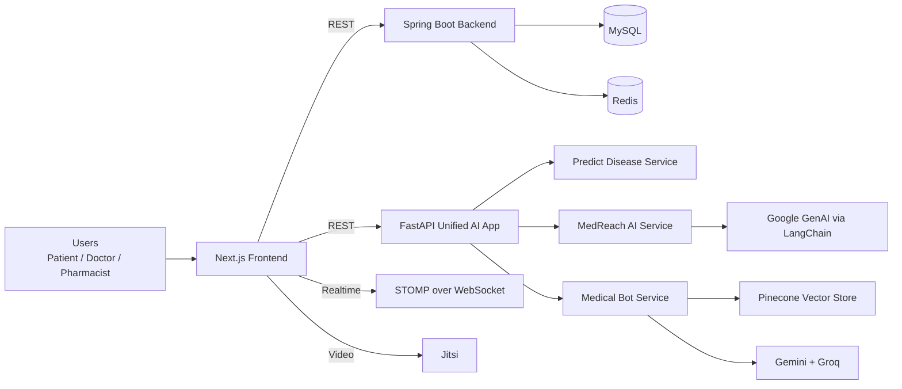

# HealthDesk (Public Version)

> **Public Version Notice**
> This repository is the **public version** of HealthDesk. It showcases architecture, core workflows, and implementation quality for review/demo purposes. Sensitive deployment details, production secrets, and some operational integrations are intentionally excluded.

HealthDesk is a multi-service healthcare platform designed for both:
- **real-time consultation** (live doctor interaction), and
- **asynchronous care** (store-and-forward consults for unstable/low-bandwidth networks).

It combines a modern web frontend, a Java backend, and Python AI services to support patients, doctors, and pharmacies within one coordinated system.

## Contributors

- **Java backend:** [Kartik nhm](https://github.com/Hellf0rg0d), [shrihari deshapande](https://github.com/shrihari-des18)
- **Frontend UI/UX:** [Sudhanva Kulkarni](https://github.com/Sudhanva-Kulkarni)
- **Frontend (Next.js + API integrations) & AI:** [Me](https://github.com/Akenzz)

## Elevator pitch

HealthDesk solves a practical healthcare gap: many users cannot always get an immediate live consultation because of connectivity issues or doctor availability. The platform enables users to still receive care through **MedReach asynchronous submissions**, AI-assisted triage/summarization, and later doctor responses, while preserving the option for real-time sessions.

## Problem statement

Traditional telemedicine often assumes:
- stable internet,
- immediate doctor availability,
- continuous synchronous communication.

In many real-world environments, these assumptions fail. HealthDesk addresses this by introducing a resilient hybrid model:
- **Live-first when possible**,
- **Asynchronous fallback when necessary**,
- **AI support layer** to accelerate review and response quality.

## Product capabilities

### 1) Identity, access, and session management
- Role-oriented flows for patient, doctor, and pharmacist personas
- OTP-supported onboarding and verification pathways
- Token/JWT-based authentication and secured route handling
- Middleware-protected app surfaces for role-sensitive pages

### 2) Patient-facing modules
- Patient dashboard with quick access to consultations and records
- Live consultation flow via embedded Jitsi call experience
- MedReach async consultation submission with specialty routing
- Records and history views for ongoing care continuity

### 3) Doctor-facing modules
- Doctor dashboard with queue-oriented workload visibility
- Async case response flow for MedReach requests
- Access to transcripts, summaries, and patient detail context
- Availability signaling for real-time consultation routing

### 4) AI-powered assistance
- **Medical Chatbot API** for contextual health Q&A
- **Symptom prediction service** returning top probable conditions
- **MedReach analysis pipeline** that generates concise summaries and severity labels before forwarding to backend systems

### 5) Pharmacy and inventory workflows
- Pharmacy registration/listing/search capabilities
- Medicine CRUD and discoverability flows
- Inventory stock management and medicine availability lookup
- Nearby inventory checks for improved patient access

### 6) Documents and notifications
- Patient document upload + retrieval support
- Notification routes for request-driven interactions

## High-level architecture



## Service-level architecture

### Frontend (Next.js App Router)
Path: `src/`

Responsibilities:
- User journeys for authentication, dashboards, records, MedReach, and pharmacy interfaces
- Client-side media handling and conversion for async consultation flows
- Realtime signaling integration with STOMP client
- Integration with backend REST APIs and AI endpoints

Notable integrations in frontend codebase:
- `@stomp/stompjs` for live signaling
- `@ffmpeg/ffmpeg` + `@ffmpeg/util` for browser-side media processing
- Jitsi external API for live call UI/experience

### Backend (Spring Boot)
Path: `Backend/`

Responsibilities:
- Auth/session-related APIs
- Patient/doctor data workflows
- Inventory/pharmacy/document APIs
- Realtime WebSocket/STOMP infrastructure
- Integration hooks for transcription/summarization pipelines
- Persistence and caching with MySQL + Redis

Primary API groups:
- `/healthdesk/auth`
- `/healthdesk/send/data`
- `/healthdesk/read/data`
- `/healthdesk/documents`
- `/healthdesk/pharmacies`
- `/healthdesk/medicines`
- `/healthdesk/inventory`
- `/healthdesk/notification`

### AI stack (FastAPI unified app)
Path: `Health-Desk-AI/`

The unified FastAPI app mounts three services:
- `/predict-disease` (ML prediction)
- `/medreach` (summary + severity enrichment + forwarding)
- `/medical-bot` (RAG-style conversational assistant)

Service behavior summary:
- **Predict Disease**: loads model artifacts with `joblib`, maps symptom inputs to feature vectors, returns top predictions.
- **MedReach AI**: receives transcript/media metadata, runs LLM-based structured analysis, normalizes severity tier, forwards enriched payload to Java backend.
- **Medical Bot**: retrieves context from vector index, handles multilingual query conditions, and returns contextual assistant responses.

## End-to-end workflow examples

### A) Live consultation path
1. User logs in and enters consultation flow.
2. Realtime availability/signaling uses STOMP/WebSocket channels.
3. Live session is conducted via Jitsi.
4. Consultation context can be persisted through backend APIs for records and follow-up.

### B) MedReach asynchronous path
1. Patient records/submits async consultation details.
2. Frontend prepares media/transcript payload and sends to AI `/medreach/submit`.
3. AI service generates summary + severity and forwards enriched data to backend.
4. Doctor reviews async case and responds through MedReach response flows.

### C) AI assistant path
1. User asks a medical question in assistant UI.
2. Frontend calls `/medical-bot/chat`.
3. AI service retrieves relevant context + generates response.
4. Result is shown with conversation context/history.

## Technology stack

### Frontend
- Next.js 16
- React 19
- Tailwind CSS 4
- MUI
- Lucide icons
- STOMP JS client
- Browser FFmpeg

### Backend
- Java 21
- Spring Boot 3.5
- Spring Web / JPA / JDBC / WebSocket
- JWT (`jjwt`)
- MySQL connector
- Redis + Lettuce
- Maven

### AI / ML
- FastAPI + Uvicorn/Gunicorn
- LangChain ecosystem
- Google GenAI and Groq integrations
- Pinecone vector store integration
- scikit-learn, pandas, lightgbm, joblib

## Repository structure

```text
.
├── src/                    # Next.js application
├── Backend/                # Spring Boot backend
│   ├── src/main/java/      # Controllers, services, websocket/security
│   └── src/main/resources/ # application.properties and backend configs
├── Health-Desk-AI/         # FastAPI + AI/ML service modules
│   └── services/
│       ├── medreach/
│       ├── medical_bot/
│       └── predict_disease/
└── public/                 # Static assets
```

## Local setup

### 1) Frontend
```bash
cp .env.example .env.local
npm install
npm run dev
```
Default: `http://localhost:3000`

### 2) Backend
```bash
cd Backend
cp .env.example .env
./mvnw spring-boot:run
```
`application.properties` reads environment variables (including optional `.env`) so secrets stay out of source.

### 3) AI services
```bash
cd Health-Desk-AI
cp .env.example .env
pip install -r requirements.txt
uvicorn app:app --reload --port 8000
```

## Environment configuration (minimum)

### Backend
- MySQL connection settings
- Redis host/port
- JWT secret(s)
- Any external API credentials used by backend integrations

### AI services
- `JAVA_BACKEND_URL`
- `GOOGLE_API_KEY`
- `PINECONE_API_KEY` (if using vector retrieval)
- `GROQ_API_KEY` (if enabled)

## Engineering highlights for recruiters

- Multi-language, multi-runtime architecture (JavaScript + Java + Python)
- Clear separation of concerns across UI, API, and AI services
- Practical real-time + asynchronous healthcare workflow design
- Integration of LLM/RAG capabilities into product-facing journeys
- Modular service mounting with clean endpoint boundaries
- Production-minded concerns: auth, role-based control, persistence, caching, realtime channels

## Scope note

This public version focuses on demonstrating:
- product architecture,
- implementation depth,
- feature workflows,
- integration patterns.

It is intended as a portfolio/recruiter-facing representation of the broader HealthDesk system.
