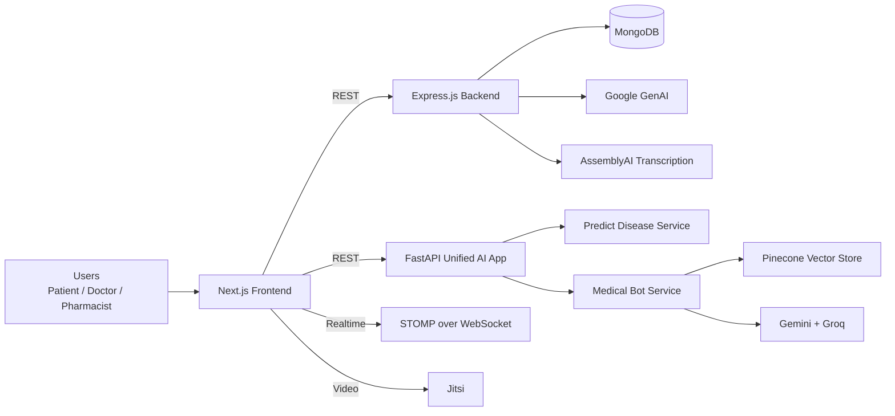

# HealthDesk (Public Version)

> **Public Version Notice**
> This repository is the **public version** of HealthDesk. It showcases architecture, core workflows, and implementation quality for review/demo purposes. Sensitive deployment details, production secrets, and some operational integrations are intentionally excluded.

HealthDesk is a multi-service healthcare platform designed for both:
- **real-time consultation** (live doctor interaction), and
- **asynchronous care** (store-and-forward consults for unstable/low-bandwidth networks).

It combines a modern web frontend, a Node.js backend, and Python AI services to support patients, doctors, and pharmacies within one coordinated system.

## Elevator pitch

HealthDesk solves a practical healthcare gap: many users cannot always get an immediate live consultation because of connectivity issues or doctor availability. The platform supports authentication, records, AI-assisted triage/summarization, and real-time sessions, allowing patients and doctors to continue coordinating care through the available dashboard and consultation workflows.

## Problem statement

Traditional telemedicine often assumes:
- stable internet,
- immediate doctor availability,
- continuous synchronous communication.

In many real-world environments, these assumptions fail. HealthDesk addresses this by introducing a resilient hybrid model:
- **Live-first when possible**,
- **Records and dashboard workflows when necessary**,
- **AI support layer** to accelerate review and response quality.

## Product capabilities

### 1) Identity, access, and session management
- Role-oriented flows for patient, doctor, and pharmacist personas
- OTP-supported onboarding and verification pathways
- Token/JWT-based authentication and secured route handling
- Middleware-protected app surfaces for role-sensitive pages

### 2) Patient-facing modules
- Patient dashboard with quick access to consultations and records
- Live consultation flow via embedded Jitsi call experience
- Audio-assisted consultation support with transcript and medical-summary processing
- Records and history views for ongoing care continuity

### 3) Doctor-facing modules
- Doctor dashboard with queue-oriented workload visibility
- Patient list, patient details, and conversation views
- Access to transcripts, summaries, and patient detail context
- Availability signaling for real-time consultation routing

### 4) AI-powered assistance
- **Medical Chatbot API** for contextual health Q&A
- **Symptom prediction service** returning top probable conditions
- **Medical summary pipeline** that generates structured summaries from consultation transcripts

### 5) Pharmacy and inventory workflows
- Pharmacy registration/listing/search capabilities
- Medicine CRUD and discoverability flows
- Inventory stock management and medicine availability lookup
- Nearby inventory checks for improved patient access

### 6) Documents and notifications
- Patient document upload + retrieval support
- Notification routes for request-driven interactions

## High-level architecture



## Service-level architecture

### Frontend (Next.js App Router)
Path: `Frontend/`

Responsibilities:
- User journeys for authentication, dashboards, records, consultation, and pharmacy interfaces
- Client-side media handling for consultation flows
- Realtime signaling integration with STOMP client
- Integration with backend REST APIs and AI endpoints

Notable integrations in frontend codebase:
- `@stomp/stompjs` for live signaling
- `@ffmpeg/ffmpeg` + `@ffmpeg/util` for browser-side media processing
- Jitsi external API for live call UI/experience

### Backend (Express.js + MongoDB)
Path: `Backend/`

Responsibilities:
- Auth/session-related APIs
- Patient/doctor data workflows
- Consultation, patient-record, and document APIs
- Realtime WebSocket/STOMP infrastructure
- Integration hooks for AssemblyAI transcription and Google GenAI summarization
- Persistence with MongoDB through Mongoose
- JWT-based authorization and OTP email delivery through Resend

Primary API groups:
- `/healthdesk/auth`
- `/healthdesk/send/data`
- `/healthdesk/read/data`
- `/healthdesk/documents`
- `/healthdesk-ws` (STOMP over WebSocket)

Implemented route examples:
- `GET /healthdesk/auth/check/email`
- `GET /healthdesk/auth/send/email`
- `GET /healthdesk/auth/check/otp/email`
- `POST /healthdesk/auth/create/patient`
- `GET /healthdesk/auth/check/password`
- `GET /healthdesk/read/data/doctor-name`
- `GET /healthdesk/read/data/patient-phone`
- `GET /healthdesk/read/data/patient-name`
- `GET /healthdesk/read/data/get-doctor-availability`
- `GET /healthdesk/read/data/patient/conversation`
- `GET /healthdesk/read/data/patient-list`
- `GET /healthdesk/read/data/patient-details`
- `POST /healthdesk/send/data/patient-details`
- `POST /healthdesk/send/data/set-doctor-availability`
- `PATCH /healthdesk/send/data/update-doctor-availability`
- `POST /healthdesk/send/data/unset-doctor-availability`
- `POST /healthdesk/send/data/conversation`
- `POST /healthdesk/documents/upload`
- `GET /healthdesk/documents/:phone`
- `GET /healthdesk/read/document/:uuid`

### AI stack (FastAPI unified app)
Path: `AI/`

The unified FastAPI app mounts two services:
- `/predict-disease` (ML prediction)
- `/medical-bot` (RAG-style conversational assistant)

Service behavior summary:
- **Predict Disease**: loads model artifacts with `joblib`, maps symptom inputs to feature vectors, returns top predictions.
- **Medical Bot**: retrieves context from vector index, handles multilingual query conditions, and returns contextual assistant responses.
- **Medical Summary**: the Node.js backend transcribes uploaded audio with AssemblyAI and uses Google GenAI to normalize consultation text into structured medical fields.

## End-to-end workflow examples

### A) Live consultation path
1. User logs in and enters consultation flow.
2. Realtime availability/signaling uses STOMP/WebSocket channels.
3. Live session is conducted via Jitsi.
4. Consultation context can be persisted through backend APIs for records and follow-up.

### B) Audio-assisted consultation path
1. Patient records or submits consultation details through the frontend.
2. Frontend sends the consultation audio or transcript through the backend workflow.
3. The backend uses AssemblyAI for transcription when audio is provided and Google GenAI for structured medical summarization.
4. The resulting consultation context is stored with the patient record for doctor review.

### C) AI assistant path
1. User asks a medical question in assistant UI.
2. Frontend calls `/medical-bot/chat`.
3. AI service retrieves relevant context + generates response.
4. Result is shown with conversation context/history.

## Technology stack

### Frontend
- Next.js 16
- React 19
- Tailwind CSS 4
- MUI
- Lucide icons
- STOMP JS client
- Browser FFmpeg

### Backend
- Node.js
- Express.js
- MongoDB + Mongoose
- JWT (`jsonwebtoken`)
- WebSocket/STOMP support with `ws`
- Resend OTP email integration
- Multer document and audio upload handling

### AI / ML
- FastAPI + Uvicorn/Gunicorn
- LangChain ecosystem for the medical bot
- Google GenAI and Groq integrations
- Pinecone vector store integration
- scikit-learn, pandas, lightgbm, joblib

## Repository structure

```text
.
├── Frontend/               # Next.js application
│   ├── src/                # App Router pages, components, and API routes
│   └── public/             # Static assets
├── Backend/                # Express.js + MongoDB backend
│   ├── src/routes/         # Auth, read, send, and document routes
│   ├── src/services/       # Transcription and medical-summary integrations
│   ├── src/models/         # Mongoose data models
│   └── src/websocket/      # STOMP over WebSocket server
├── AI/                     # FastAPI + AI/ML service modules
│   └── services/
│       ├── medical_bot/
│       └── predict_disease/
```

## Local setup

### 1) Frontend
```bash
cd Frontend
npm install
npm run dev
```
Default: `http://localhost:3000`

### 2) Backend
```bash
cd Backend
npm install
npm run dev
```
The backend runs on `http://localhost:9112` by default. Create a `.env` file and configure MongoDB and integration credentials there so secrets stay out of source.

### 3) AI services
```bash
cd AI
cp .env.example .env
pip install -r requirements.txt
python app.py
```
The AI app runs on port `8000` by default and exposes `/predict-disease` and `/medical-bot`.

## Environment configuration (minimum)

### Backend
- `MONGO_URI`
- `PORT` (defaults to `9112`)
- `JWT_SECRET` and `JWT_EXPIRES_IN`
- `PASSWORD_SALT`
- `RESEND_API_KEY` and `RESEND_FROM_EMAIL`
- `GENAI_API_KEY` and optional `GENAI_MODEL`
- `ASSEMBLYAI_API_KEY` and optional `ASSEMBLYAI_BASE_URL`
- `CORS_ORIGIN`
- Optional `CDN_DOCUMENT_BASE_URL`

### AI services
- AI service configuration required by the medical bot and prediction service
- `PINECONE_API_KEY` (if using vector retrieval)
- `GROQ_API_KEY` (if enabled)

## Engineering highlights for recruiters

- Multi-language, multi-runtime architecture (JavaScript + Python)
- Clear separation of concerns across UI, API, and AI services
- Practical real-time + audio-assisted healthcare workflow design
- Integration of LLM/RAG capabilities into product-facing journeys
- Modular service mounting with clean endpoint boundaries
- Production-minded concerns: auth, role-based control, persistence, transcription, realtime channels

## Scope note

This public version focuses on demonstrating:
- product architecture,
- implementation depth,
- feature workflows,
- integration patterns.

It is intended as a portfolio/recruiter-facing representation of the broader HealthDesk system.
